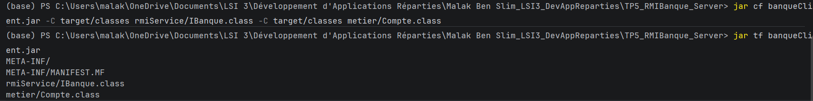
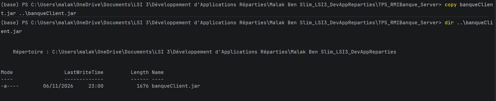
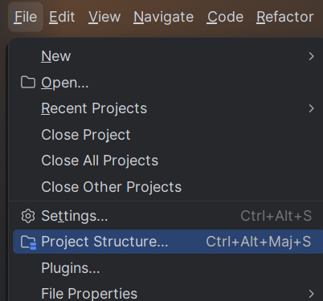
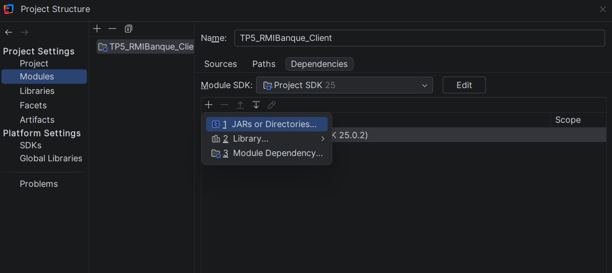
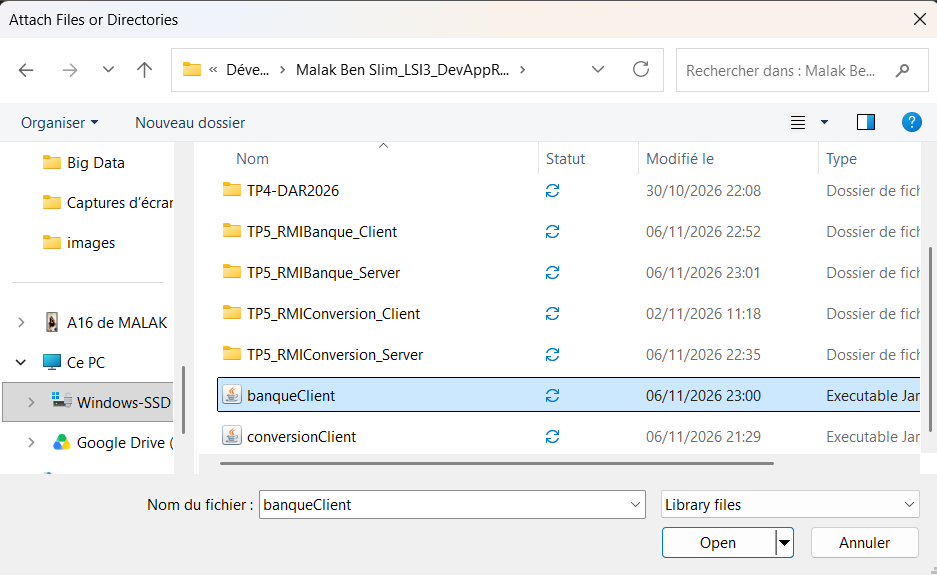
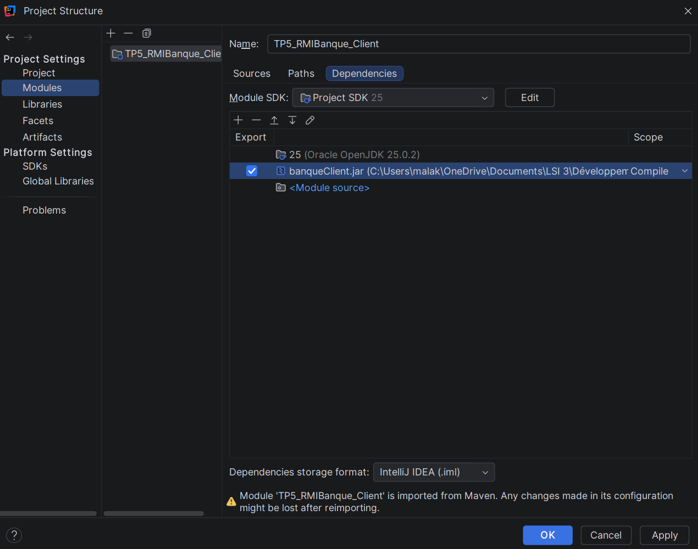
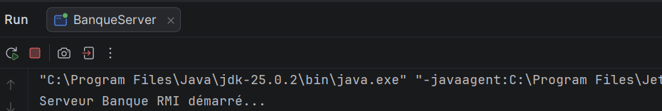
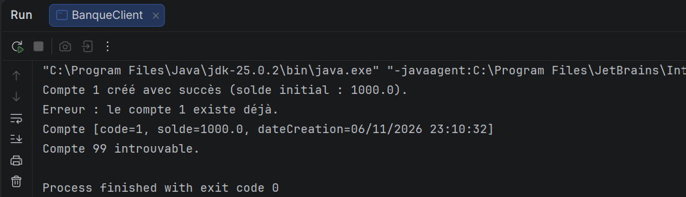
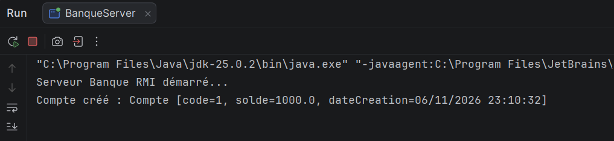

# TP 5 – Activité 5-2 : Service de banque avec Java RMI et JNDI

**Étudiante :** Malak Ben Slim
**Classe :** LSI 3
**Matière :** Développement d'Applications Réparties
**Année universitaire :** 2026 – 2027
---

## 1. Objectif

Développer une application répartie de gestion de comptes bancaires avec **Java RMI**, puis remplacer l'accès direct au registre RMI (`LocateRegistry` et `Naming`) par **JNDI** (Java Naming and Directory Interface) pour l'enregistrement et la recherche de l'objet distant.

Un compte bancaire est défini par un **code** (`int`), un **solde** (`double`) et une **date de création** (`Date`). Le serveur central offre deux services distants :

- créer un compte avec un code et une somme initiale (si le code n'existe pas déjà) ;
- consulter un compte à partir de son code.
## 3. Structure du projet

```
Malak Ben Slim_LSI3_DevAppReparties/
├── TP5_RMIBanque_Server/
│   └── src/main/
│       ├── java/
│          ├── metier/Compte.java            (classe sérialisable)
│          ├── rmiService/IBanque.java       (interface distante)
│          ├── rmiService/BanqueImpl.java    (implémentation du service)
│          └── rmiServer/BanqueServer.java   (serveur)
│               
├── TP5_RMIBanque_Client/
│   └── src/main/
│       ├── java/rmiClient/BanqueClient.java  (client)
│               
├── banqueClient.jar                          (IBanque + Compte uniquement)
├── images/
└── README_Activite5-2.md
```

## 4. Étape 2 : Développement du serveur

### Classe `Compte` (package `metier`)

Classe **sérialisable** (`implements Serializable`) avec les attributs `code`, `solde` et `dateCreation`. La date est initialisée à la création de l'objet. La sérialisation est nécessaire car un `Compte` est transmis par valeur du client vers le serveur.

### Interface distante `IBanque` (package `rmiService`)

```java
public interface IBanque extends Remote {
    String creerCompte(Compte c) throws RemoteException;
    String getInfoCompte(int code) throws RemoteException;
}
```

### Implémentation `BanqueImpl` (package `rmiService`)

`BanqueImpl` étend `UnicastRemoteObject` et implémente `IBanque`. Les comptes sont stockés dans une `ConcurrentHashMap<Integer, Compte>` :

- `creerCompte` utilise `putIfAbsent` : si le code existe déjà, un message d'erreur est renvoyé, sinon le compte est créé ;
- `getInfoCompte` renvoie les informations du compte, ou « introuvable » si le code est inconnu.
### Serveur `BanqueServer` (package `rmiServer`)

Version de l'étape 4 : activation du registre avec `LocateRegistry.createRegistry(1099)`, création de `BanqueImpl`, puis publication avec `Naming.rebind("rmi://localhost:1099/BanqueService", banque)`.

## 5. Étape 3 : Développement du client

### 5.1 Génération de `banqueClient.jar`

Seules l'interface `IBanque` et la classe `Compte` sont exportées (sans `BanqueImpl`) :




Copie du jar dans l'espace de travail :



### 5.2 Ajout du jar au classpath du projet client

Menu **File → Project Structure** :



Onglet **Modules → Dependencies → + → JARs or Directories** :



Sélection du fichier `banqueClient.jar` :



Le jar apparaît dans les dépendances du module client :



### 5.3 Classe `BanqueClient` (package `rmiClient`)

Le client récupère la référence de l'objet distant `IBanque`, puis :

1. crée le compte de code 1 avec un solde initial de 1000 ;
2. tente de recréer le même code (une erreur est attendue) ;
3. consulte le compte 1 ;
4. consulte le compte 99 (inexistant).
## 6. Étape 4 : Exécution de l'application (RMI classique)

**Démarrage du serveur :**



**Exécution du client :**



Résultat obtenu :

- le compte 1 est créé avec succès (solde initial 1000.0) ;
- la seconde création du compte 1 est refusée (« le compte 1 existe déjà ») ;
- la consultation du compte 1 affiche son code, son solde et sa date de création ;
- la consultation du compte 99 indique qu'il est introuvable.
  **Console du serveur après l'appel du client :** le serveur affiche la création du compte, ce qui prouve que la méthode a bien été exécutée côté serveur.




## 8. Synthèse

Cette activité m'a permis de développer une application répartie bancaire avec Java RMI, puis d'y intégrer JNDI.

- **Passage par valeur et par référence** : la classe `Compte` est sérialisable, donc un `Compte` créé par le client est copié (sérialisé) vers le serveur. En revanche, l'objet `BanqueImpl` n'est pas copié : le client en manipule un **stub**, et les appels sont exécutés côté serveur.
- **Rôle du jar** : `banqueClient.jar` contient l'interface `IBanque` et la classe `Compte`, c'est-à-dire tout ce que le client doit connaître. L'implémentation `BanqueImpl` reste sur le serveur.
- **Gestion des doublons** : `putIfAbsent` sur une `ConcurrentHashMap` garantit qu'un code de compte n'est créé qu'une fois, même avec plusieurs clients simultanés.
  Le test final confirme le bon fonctionnement de l'application avec RMI seul, puis avec JNDI.
 